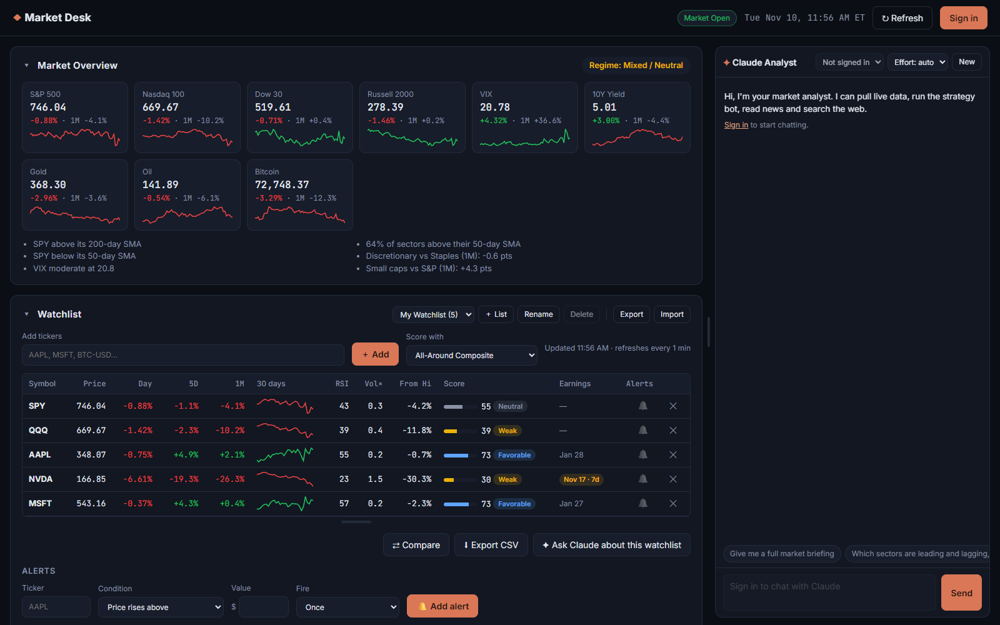
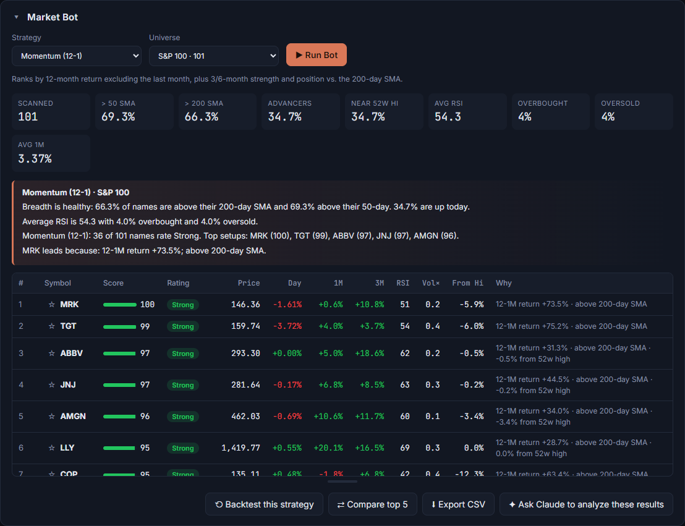
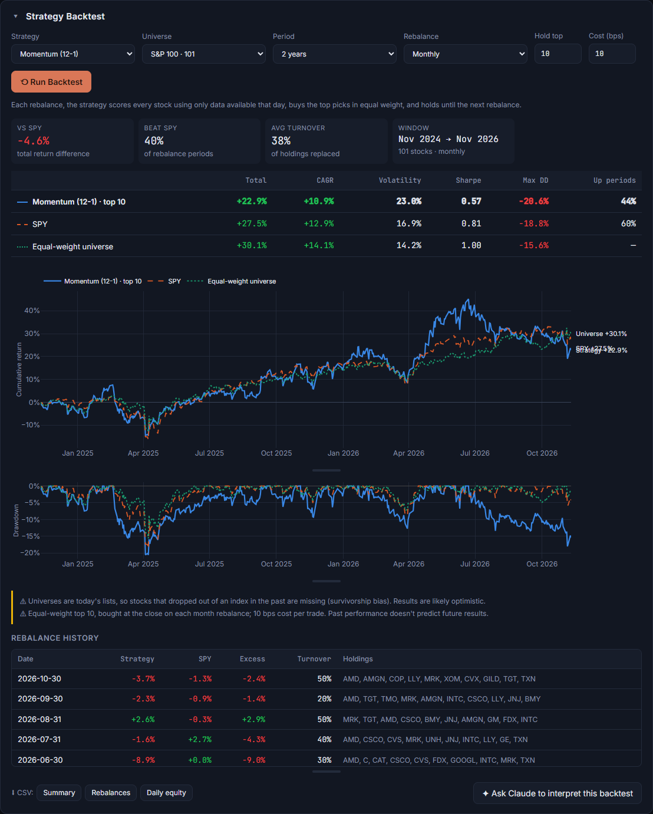
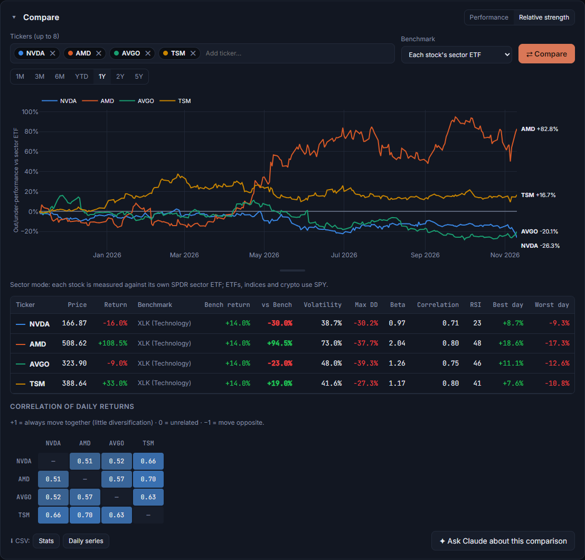
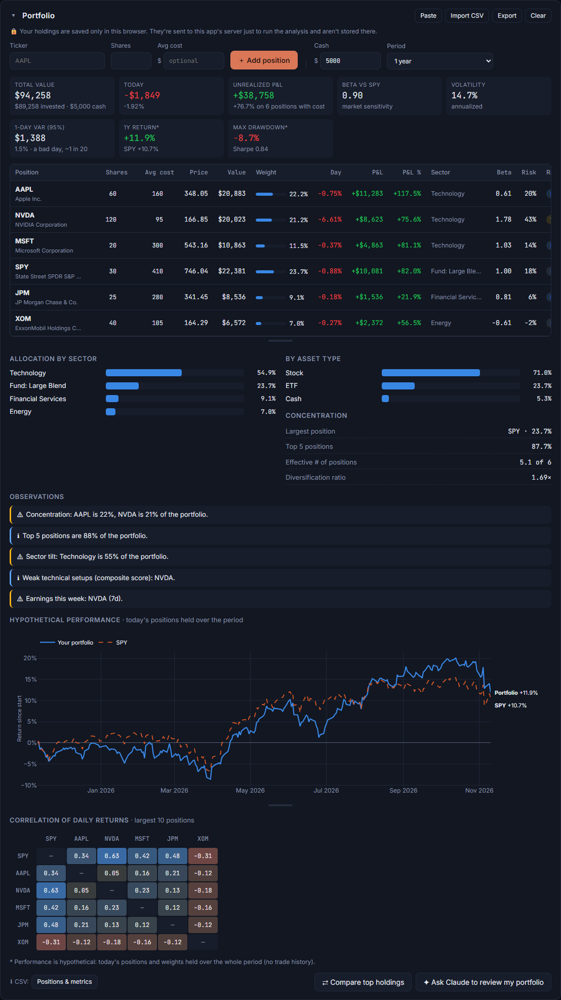
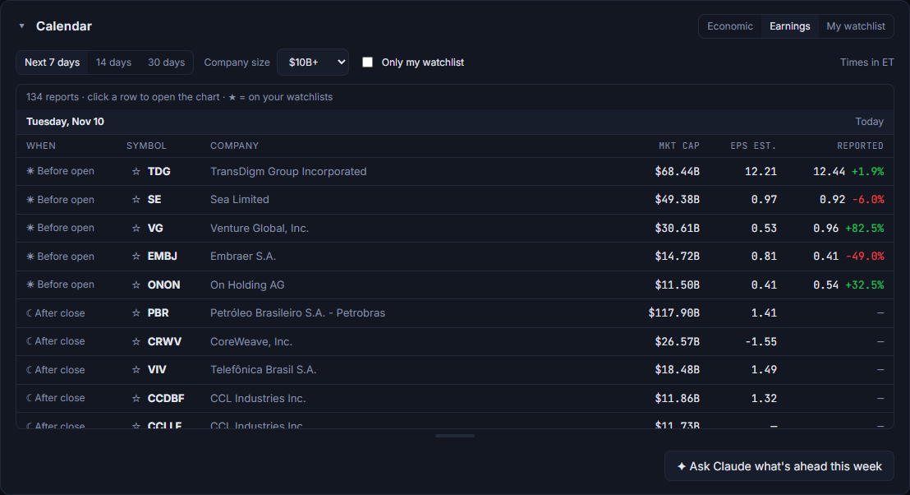
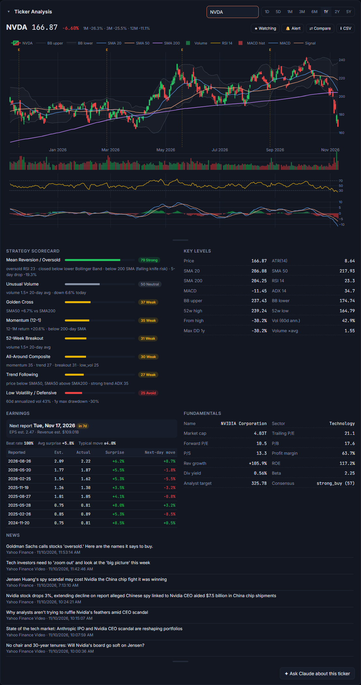

# Market Desk

A stock market analysis dashboard with a strategy-driven **market bot** and a built-in
**Claude analyst** you can chat with about live market data.



- **Market overview:** indices, VIX, yields, commodities and crypto, plus a Risk-On / Risk-Off regime read
- **Watchlists & alerts:** multiple lists with live stats and strategy scores; 15 alert types (price, % move, RSI, strategy score, moving-average crosses, volume spikes, upcoming earnings) with desktop notifications
- **Portfolio analysis:** enter holdings or import a broker CSV to get P&L, allocation, concentration, beta, volatility, Value-at-Risk, risk contribution per position, correlations and plain-language observations
- **Sector rotation:** all 11 sectors ranked over 1D / 1W / 1M / 3M / YTD
- **Calendar:** US economic releases tagged by impact, market-wide earnings (before open / after close, EPS estimates and surprises), and your watchlist's report dates
- **Market bot:** pick a strategy and a stock list from the dropdowns to get ranked scores, reasons and breadth stats
- **Backtesting:** test any strategy over 1–5 years with monthly or weekly rebalancing and trading costs, against SPY and an equal-weight baseline, with no look-ahead
- **Ticker analysis:** candlesticks, moving averages, Bollinger Bands, RSI, MACD, every strategy's score, fundamentals, earnings history (with the typical post-report move) and news
- **Compare:** up to 8 tickers by indexed performance or relative strength vs SPY, QQQ or each stock's own sector ETF, with beta, drawdown and a correlation matrix
- **CSV export:** scans, backtests, watchlists, comparisons, portfolios and price history with indicators
- **Resizable layout:** draggable chat panel, resizable charts and tables, collapsible sections
- **Claude analyst:** streaming chat where Claude pulls live data, runs the bot, backtests, compares, reads the calendar, analyzes portfolios and searches the web
- **Sign in / sign out:** each person connects their own Claude access

Your watchlists, alerts and portfolio are stored **only in your browser** (with Export/Import for
backups). The server never saves them.

Market data comes from Yahoo Finance via [`yfinance`](https://github.com/ranaroussi/yfinance). It's free,
needs no key, and intraday prices are delayed about 15 minutes.

> This is an analysis tool, not financial advice.

## Screenshots

| Market bot | Strategy backtest |
|---|---|
|  |  |
| **Compare** | **Portfolio analysis** |
|  |  |
| **Calendar** | **Ticker analysis** |
|  |  |

<sub>Screenshots use demo holdings and a sample watchlist.</sub>

## Quick start

Requires Python 3.11+.

```bash
git clone https://github.com/ZaneWill77/Market-Desk.git
cd Market-Desk
```

- **Windows:** double-click `run.bat`
- **macOS / Linux:** `./run.sh`

Then open http://127.0.0.1:8765. The dashboard works right away. To chat with Claude, click **Sign in**.

## Signing in to the Claude analyst

The market dashboard and strategy bot are free and need no account. The **Claude analyst chat**
needs an **Anthropic API key**:

1. Create a key at [console.anthropic.com](https://console.anthropic.com/settings/keys). Usage is billed to your Anthropic API account, which is separate from a Claude Pro/Max subscription.
2. Click **Sign in** and paste the key.
3. Click **Sign out** when you're done.

Why not "Sign in with Claude"? Anthropic's terms don't allow third-party apps to offer claude.ai
login or to use Claude Pro/Max plans on their users' behalf
([details](https://code.claude.com/docs/en/legal-and-compliance#authentication-and-credential-use)).
API keys are the supported way for apps like this one.

How your key is handled:

- It's checked with Anthropic, then held **only in the server's memory**, tied to your browser session by an HttpOnly cookie.
- It's never written to disk, never sent back to the browser, and is erased when you sign out, when the session expires (12 hours of inactivity by default), or when the server restarts.
- In this app Claude has no file or shell access. It can only use the market tools and web search.

**Hosting it for others?** Serve it over HTTPS (set `SECURE_COOKIES=1`) and remember that users are
trusting your server with their API key. For most people, running it locally is the better choice.

## Configuration

Copy `.env.example` to `.env`. The launchers read it.

| Variable | Default | Purpose |
|---|---|---|
| `PORT` | `8765` | Port to serve on |
| `HOST` | `127.0.0.1` | Interface to bind (keep local unless you're deploying) |
| `SESSION_TTL_HOURS` | `12` | Idle time before sign-in expires |
| `SECURE_COOKIES` | `0` | Set to `1` behind HTTPS |

## Project layout

```
app/
  server.py           FastAPI routes: data API, sign-in/out, streaming chat
  auth.py             in-memory sessions (HttpOnly cookie → session)
  config.py           settings from environment variables
  bot.py              market overview, regime, scanner
  backtest.py         strategy backtester (causal, equal-weight top-N)
  compare.py          indexed / relative performance, beta, correlations
  calendar_data.py    earnings + economic calendars, per-ticker earnings history
  portfolio.py        portfolio analytics and observations
  alerts.py           alert condition types
  indicators.py       RSI, MACD, Bollinger, ADX, ATR, returns, volatility
  market_data.py      yfinance access + caching
  tools.py            tools Claude can call (shared by all providers)
  strategies/         one file per strategy, auto-discovered
  providers/          AI backends (anthropic_api.py: Claude API with the user's key)
  data/universes.json stock lists for the scanner
static/               dashboard UI (vanilla JS + Plotly)
tests/                offline test suite (pytest)
```

## Extending it

The project is built so most additions touch **one file**:

- **New strategy:** copy `app/strategies/_template.py` to a new file and write a scoring function. It shows up in the dropdown, the scanner, the scorecard and Claude's tools automatically.
- **New stock list:** add an entry to `app/data/universes.json`.
- **New alert type:** add an `AlertType` to `ALERT_TYPES` in `app/alerts.py`. It appears in the alert form automatically.
- **Economic event importance:** edit `IMPACT_RULES` in `app/calendar_data.py`.
- **New portfolio observation:** add a rule in `_observations()` in `app/portfolio.py`.
- **New Claude tool:** add a function with `@market_tool(...)` in `app/tools.py`. Every provider picks it up.
- **New AI provider:** add a module in `app/providers/` following the interface in `providers/base.py`.

See [CONTRIBUTING.md](CONTRIBUTING.md) for details.

## Development

```bash
python -m venv .venv
.venv/bin/pip install -r requirements-dev.txt   # Windows: .venv\Scripts\pip
.venv/bin/python -m pytest                      # offline tests, no network needed
.venv/bin/python -m app                         # run the server
```

## License

[MIT](LICENSE)
